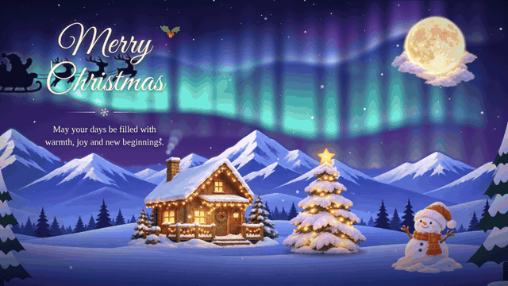

# christmas-aurora

A magical animated Christmas scene for React. One component gives you waving northern lights, drifting snow, moonlit mountains, a cosy log hut with a smoking chimney, a snow-covered Christmas tree, a snowman and Santa's sleigh flying across the sky. Move the cursor over the snowman or Santa and they call out a greeting.



- **One import, no setup.** Styles are bundled with the component; there is no CSS file to import.
- **Self-contained.** No dependencies beyond React and nothing to host: the illustrations are embedded in the bundle (about 460 kB gzipped).
- **Smooth.** Canvas for the aurora and snow, SVG and CSS transforms for everything else. Animation stops when the scene is off screen or the tab is hidden.
- **Considerate.** Respects `prefers-reduced-motion`, never autoplays audio, and cleans up every loop, timer and listener on unmount.
- **Typed.** Written in TypeScript, ships ESM and CommonJS builds, and works with server rendering.

## Installation

```bash
npm install christmas-aurora
```

`react` and `react-dom` 18 or newer are peer dependencies.

## Usage

```tsx
import { ChristmasAurora } from "christmas-aurora";

function App() {
  return (
    <ChristmasAurora
      snowfall={true}
      aurora={true}
      santa={true}
      snowman={true}
      background="dusk"
    />
  );
}

export default App;
```

Every prop is optional, so `<ChristmasAurora />` on its own renders the full scene.

### As a page background

By default the scene is pinned to the viewport (`position: fixed`). Pass your page content as children and it is layered on top:

```tsx
<ChristmasAurora>
  <main style={{ position: "relative", padding: 48 }}>
    <h1>Our winter sale starts today</h1>
  </main>
</ChristmasAurora>
```

If you would rather keep your content outside the component, give it `position: relative` (or a `z-index`) so it sits above the scene. The scene's own stacking level is `0` and can be changed with the `--ca-z-index` CSS variable.

### Inside a section

Set `fullScreen={false}` and the scene fills its parent instead. The parent needs a height:

```tsx
<section style={{ height: 520 }}>
  <ChristmasAurora fullScreen={false} title="Season's Greetings" message="From all of us at Acme." />
</section>
```

The artwork scales to any shape, from a phone screen to a wide banner.


## Props

| Prop | Type | Default | Description |
| --- | --- | --- | --- |
| `snowfall` | `boolean` | `true` | Falling snow. |
| `aurora` | `boolean` | `true` | Animated northern lights. |
| `santa` | `boolean` | `true` | Santa, his sleigh and reindeer flying across the sky. |
| `snowman` | `boolean` | `true` | The snowman on the right of the scene. |
| `christmasTree` | `boolean` | `true` | The snow-covered Christmas tree. |
| `hut` | `boolean` | `true` | The log hut with glowing windows and chimney smoke. |
| `sound` | `boolean` | `false` | Shows a sound button. Nothing plays until the visitor presses it. See [Sound](#sound). |
| `speed` | `number` | `1` | Animation speed multiplier, from `0` (frozen) to `4`. |
| `intensity` | `number` | `1` | Snowfall density multiplier, from `0` to `4`. |
| `title` | `string \| false` | `"Merry Christmas"` | The large headline. `false` hides it. |
| `message` | `string \| false` | `"May your days be filled with warmth, joy and new beginnings."` | The greeting under the headline. `false` hides it. |
| `background` | `"night" \| "midnight" \| "dusk"` | `"dusk"` | Sky colour theme. |
| `fullScreen` | `boolean` | `true` | `true` pins the scene to the viewport; `false` fills the parent element. |
| `className` | `string` | – | Extra class names for the root element. |
| `style` | `CSSProperties` | – | Inline styles for the root element. |
| `children` | `ReactNode` | – | Content rendered on top of the scene. |

Any other `<div>` attribute (`id`, `data-*`, `aria-*`, event handlers) is passed to the root element, and `ref` is forwarded to it.

## Customization examples

A blizzard at midnight, with no characters:

```tsx
<ChristmasAurora background="midnight" intensity={3} speed={1.5} santa={false} snowman={false} />
```

Your own greeting:

```tsx
<ChristmasAurora title="Happy Holidays" message="Wishing you a peaceful season and a bright new year." />
```

Just the landscape, with no text:

```tsx
<ChristmasAurora title={false} message={false} />
```

### Fonts and colours

The scene exposes a few CSS variables. Set them through `style` or your own stylesheet:

| Variable | Default | Purpose |
| --- | --- | --- |
| `--ca-font-title` | `'Great Vibes', 'Snell Roundhand', 'Segoe Script', cursive` | Headline font. |
| `--ca-font-body` | `Georgia, serif` | Greeting font. |
| `--ca-text` | `#fff6df` | Text colour. |
| `--ca-sky` | theme gradient | Any CSS background, to replace the sky entirely. |
| `--ca-z-index` | `0` | Stacking level in full-screen mode. |

```tsx
<ChristmasAurora style={{ "--ca-font-title": "'Pacifico', cursive" } as React.CSSProperties} />
```

The package does not load any web fonts. The headline looks best in a script face, so if you want the look from the screenshots, add [Great Vibes](https://fonts.google.com/specimen/Great+Vibes) to your page; otherwise the visitor's system script font is used.

### Sound

`sound` is off by default. When you turn it on, a small speaker button appears in the corner of the scene, and audio starts only when the visitor presses it: soft wind, sleigh bells and a "wee!" when the visitor hovers over Santa or the snowman. All sounds are synthesised with the Web Audio API, so no audio files are downloaded.

```tsx
<ChristmasAurora sound />
```

### Next.js

The bundle is marked `"use client"`, so it can be imported straight into a Server Component in the App Router. It renders on the server and starts animating after hydration.

## Accessibility and performance

- With `prefers-reduced-motion: reduce`, the scene is drawn as a still picture: no animation loops run and Santa hovers by the moon.
- The decorative artwork is hidden from assistive technology. The headline and greeting are real text.
- Canvas loops pause when the component scrolls out of view or the tab is hidden, and the aurora is rendered at a low internal resolution and capped at 30 fps.
- Unmounting cancels all animation frames, timers, observers and audio.

## Browser compatibility

Current versions of Chrome, Edge, Firefox and Safari (desktop and mobile). The scene relies on CSS `aspect-ratio`, `inset`, individual transform properties and `ResizeObserver`, which puts the practical minimum at Chrome 104, Edge 104, Firefox 103 and Safari 15.4. Internet Explorer is not supported.

## Development

```bash
npm install
```

Run the demo with hot reload at http://localhost:5173:

```bash
npm run dev
```

Run the tests, type check and library build:

```bash
npm test
```

```bash
npm run typecheck
```

```bash
npm run build
```

The source is organised as:

```
src/
  components/   React components (scene, hut, tree, snowman, Santa, ...)
  animations/   Canvas renderers, hooks and the sound engine
  assets/       Generated artwork: mountains, forest, stars, pine shapes
  styles/       The scene stylesheet (inlined into the bundle at build time)
  types/        Public TypeScript types
  index.ts      Package entry
example/        Demo app with live controls for every prop
tests/          Vitest suite
```

### Publishing

`npm publish` runs the type check, tests and build first (`prepublishOnly`). Only `dist/`, the README and the licence are published.

```bash
npm login
```

```bash
npm publish
```

## License

[MIT](./LICENSE)
